# FlagOS architecture atlas

Code snapshot: **2026-10-21**, repository HEAD **485a37e**. These are
**as-implemented, logical views**, not a proposed redesign or an inspection of the
currently deployed revision. No production data or credentials are embedded.

## Reading the diagrams

Rendered SVGs below work without a Mermaid extension or network connection.
Each expandable source block is editable Mermaid. C4 views use Mermaid flowcharts
with explicit people, system, container and component boundaries for portability;
they follow C4 levels but do not use Mermaid's experimental C4 syntax.

- Solid arrows: calls, data access or ownership, as labeled.
- Dotted arrows: optional paths, logical references or delivery/configuration.
- A C4 **container** is a running application or data store, not necessarily Docker.
- ER relationships are logical references, **not** database-enforced foreign keys.
- Browser state, Firestore source records and derived caches are separate things.
- Permission labels describe the relevant layer; a UI guard is not an API or
  Firestore authorization mechanism.

| View | Use it to verify |
|---|---|
| [1. C4 context](#1-c4-system-context) | Actors and external systems |
| [2. C4 containers](#2-c4-containers-and-trust-boundaries) | Browser/server/database boundaries |
| [3. C4 components](#3-c4-component-view) | Actual code responsibilities |
| [4. Data model](#4-logical-firestore-data-model) | Team, league, match and private-data ownership |
| [5. UML classes](#5-uml-playbook-domain-model) | Editable diagrams versus recorded game plays |
| [6. Summary sequence](#6-uml-stat-summary-sequence) | Loading, cache hits, corrections and read costs |
| [7. Save sequence](#7-uml-playbook-save-sequence) | Local edits versus acknowledged cloud saves |
| [8. Route scope](#8-team-league-and-demo-scope) | Real independent teams versus demo state |
| [9. Deployment](#9-deployment-and-local-development) | Production services versus local emulators |

## 1. C4 system context


Editable Mermaid source

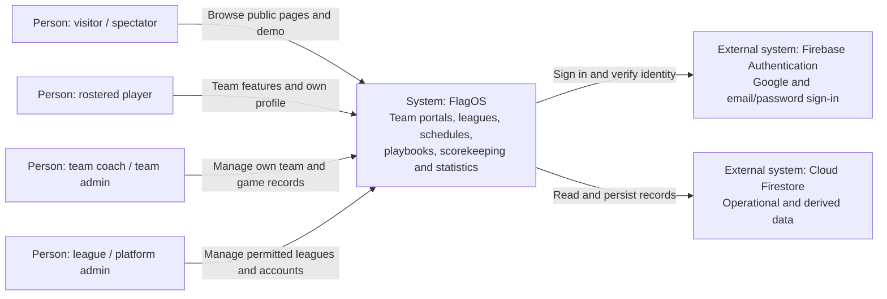

**Check:** public independent-team profiles do not imply public playbooks. The
[route guard](../src/components/AuthGuard.tsx) exempts selected public team pages,
not the playbook route. Each feature still has its own permissions.

## 2. C4 containers and trust boundaries


Editable Mermaid source

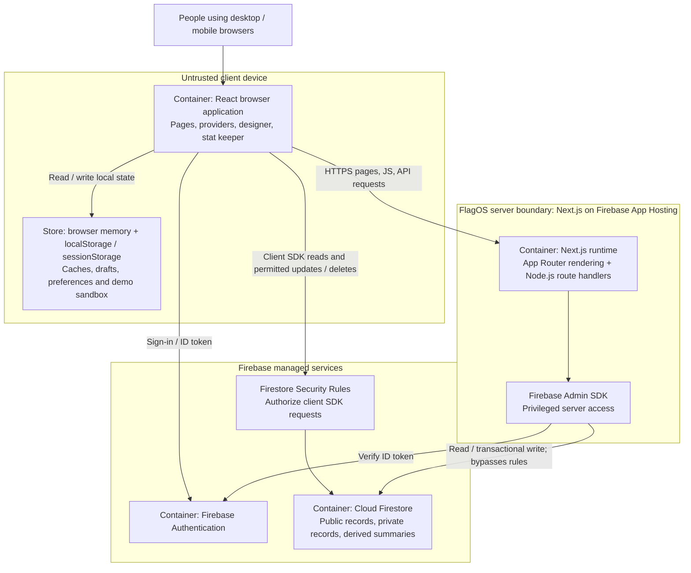

**Evidence:** [root layout](../src/app/layout.tsx),
[browser Firebase setup](../src/lib/firebase.ts),
[server Firebase setup](../src/lib/firebaseAdmin.ts),
[secure request helper](../src/lib/secureWrites.ts),
[Firestore rules](../firestore.rules).

**Important:** this is not a server-only repository pattern. For example,
[async scorekeeping](../src/components/AsyncPlayByPlayManager.tsx) creates plays
through the secure API but also updates match state and deletes a play through
the client SDK. Rules remain relevant even when a page uses an API elsewhere.
Admin SDK requests do not run through those rules; route handlers must authorize
their own requests.

## 3. C4 component view


Editable Mermaid source

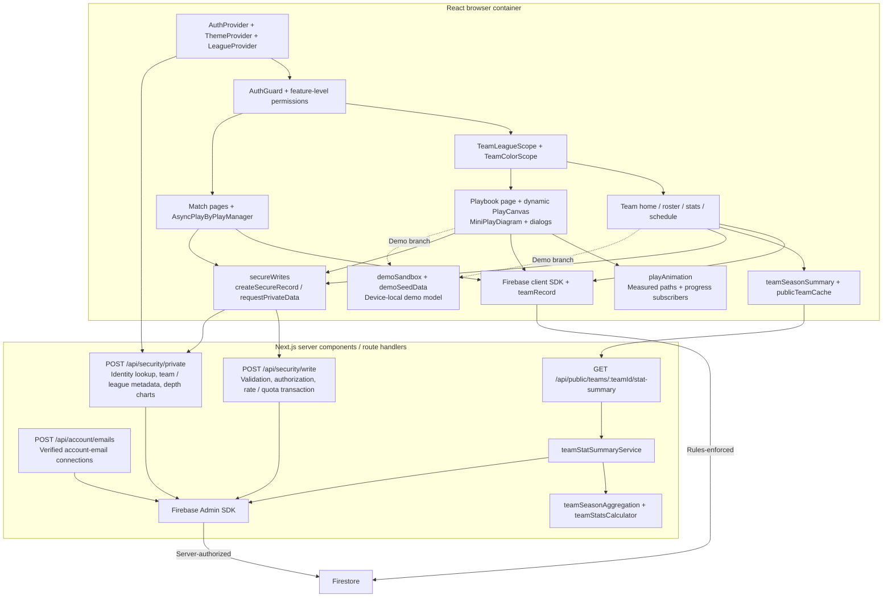

This is a dependency view, not a claim that every interaction traverses every
component. Optional UI is dynamically loaded in several places, but **not all demo
imports are lazy**: [TeamColorScope](../src/lib/teamColorContext.tsx) currently
imports the sandbox directly. Confirm bundle behavior with measurement rather
than treating the component boundary as a guaranteed code-split boundary.

**Evidence:** [providers](../src/app/layout.tsx),
[team layout](../src/app/teams/[id]/layout.tsx),
[team pages](../src/app/teams/[id]),
[playbook page](../src/app/teams/[id]/playbook/page.tsx),
[animation model](../src/components/playbook/playAnimation.ts),
[write API](../src/app/api/security/write/route.ts),
[private API](../src/app/api/security/private/route.ts),
[email API](../src/app/api/account/emails/route.ts).

## 4. Logical Firestore data model


Editable Mermaid source

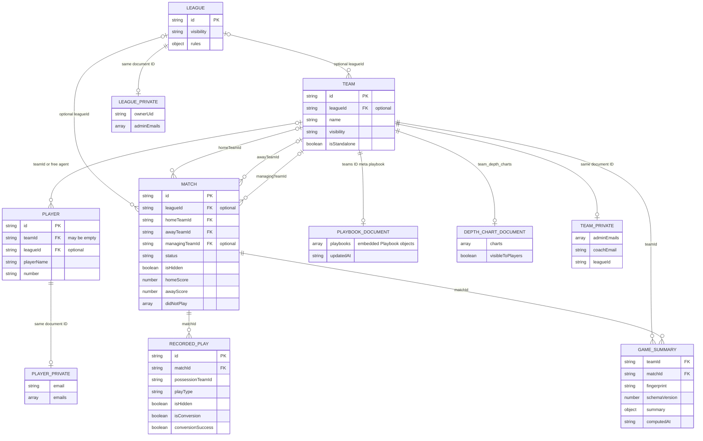

Collection mapping:

| Diagram entity | Actual collection / path | Meaning |
|---|---|---|
| LEAGUE, TEAM, PLAYER, MATCH | `leagues`, `teams`, `players`, `matches` | Operational records |
| RECORDED_PLAY | `plays` | Recorded game event, not a drawn play |
| PLAYBOOK_DOCUMENT | `teams/{teamId}/meta/playbook` | One document containing all books |
| DEPTH_CHART_DOCUMENT | `team_depth_charts/{teamId}` | Charts and player-visibility setting |
| GAME_SUMMARY | `team_stat_game_summaries/{teamId}__{matchId}` | Rebuildable derived cache |
| Private entities | `league_private`, `team_private`, `player_private` | Server-mediated PII / membership |

An independent team's `leagueId` is absent/empty. An opponent placeholder on a
match can have an ID without a matching `teams` document, so the home/away
relationships are optional. Free agents can have an empty `teamId`.

Not shown to keep the diagram readable: `users`, `red_plays`,
`registration_submissions`, `write_counters`, `user_write_limits`,
`user_private_read_limits`, and account-email connection/address/member/limit
collections. These are not additional independently deployed services.

The `Demo*` interfaces are reused by live features and allow additional fields;
they are not a complete enforced Firestore schema. Player attribution in stats
also uses recorded name strings; do not assume every player-looking value is a
document foreign key.

**Evidence:** [shared record types](../src/lib/demoSeedData.ts),
[write API persistence](../src/app/api/security/write/route.ts),
[summary service](../src/lib/teamStatSummaryService.ts),
[rules](../firestore.rules).

## 5. UML playbook domain model


Editable Mermaid source

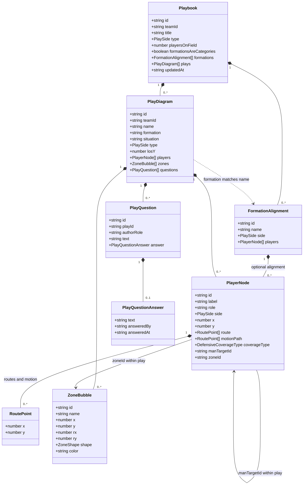

Fields shown are a subset; optional TypeScript members are not all marked optional
in this compact view. Coordinates are field percentages. `PlayerNode` is a
**diagram position**, not a roster player. `PlayDiagram` is a tactical drawing,
not an event in `plays`. `formation` references a **name**, not a formation ID.
The five-book maximum is an application constraint, not a class cardinality.
Depth chart formation keys are derived as `bookId:formationId`.

For man coverage, the [animation model](../src/components/playbook/playAnimation.ts)
applies the receiver's displacement to the defender's starting position. It
preserves the starting cushion; it does not place both players on identical
coordinates.

**Evidence:** [domain interfaces](../src/lib/playbookTypes.ts),
[depth chart mapping](../src/lib/depthChart.ts).

## 6. UML stat-summary sequence

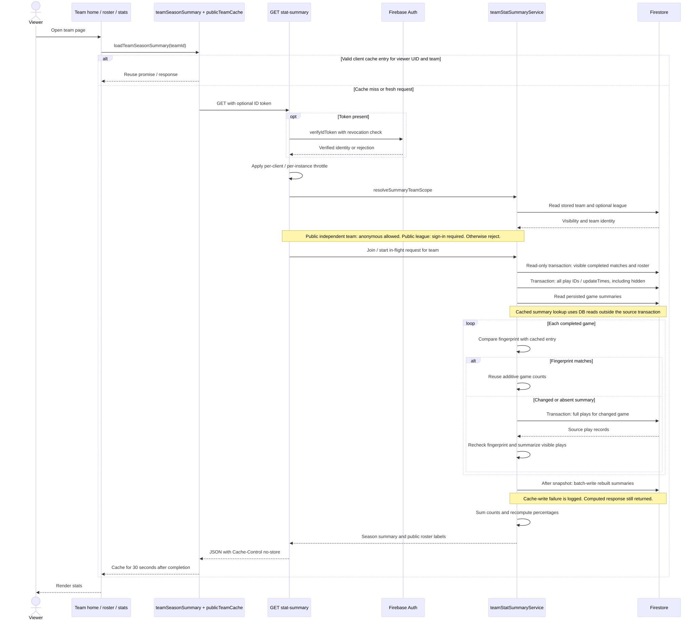

Editable Mermaid source

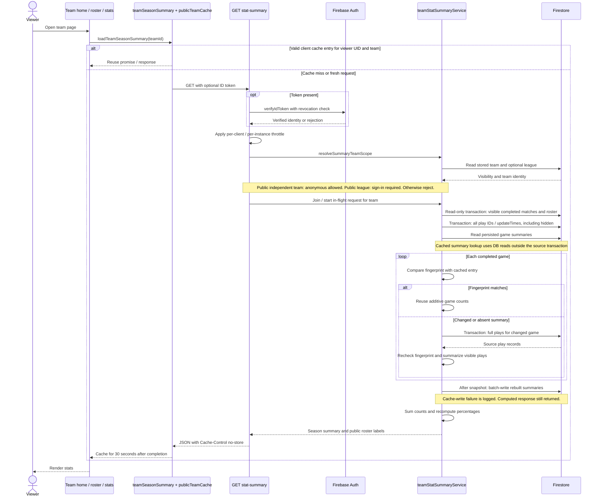

The public scope read occurs before the source-data transaction; the diagram does
not imply a transaction covering every read. Cache fingerprints include the match
update time, **all** play IDs/update times, team identity and schema version.
Changes, hidden/unhidden plays and deletions invalidate the game fingerprint.

Client cache entries are viewer-scoped and cleared on focus, storage events,
`flagos-public-data-changed`, and successful secure writes. Explicit `fresh: true`
bypasses client reuse. The server shares only concurrent requests, not a retained
HTTP response cache.

**Latency versus cost:** metadata projections reduce payload, not per-document
Firestore billing. The service still reads metadata for every game's plays.
Current limits: 64 completed games, 1,000 plays/game; oversized data or repeated
concurrent changes produce explicit errors rather than partial totals.

Private/non-public teams do not get this public summary. Team pages have
authorized client-side fallback paths; the API does not silently publish their
private source records.

**Evidence:** [client contract](../src/lib/teamSeasonSummary.ts),
[client cache](../src/lib/publicTeamCache.ts),
[summary route](../src/app/api/public/teams/[teamId]/stat-summary/route.ts),
[summary service](../src/lib/teamStatSummaryService.ts),
[detailed correctness/cost notes](team-stat-summaries.md).

## 7. UML playbook-save sequence

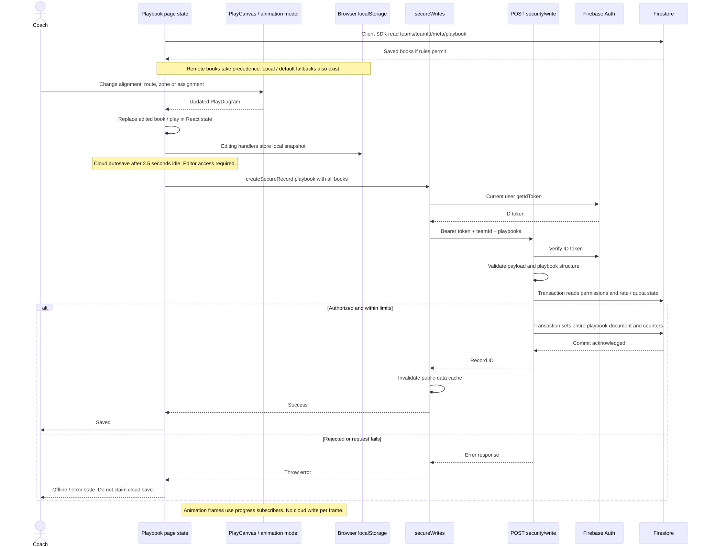

Editable Mermaid source

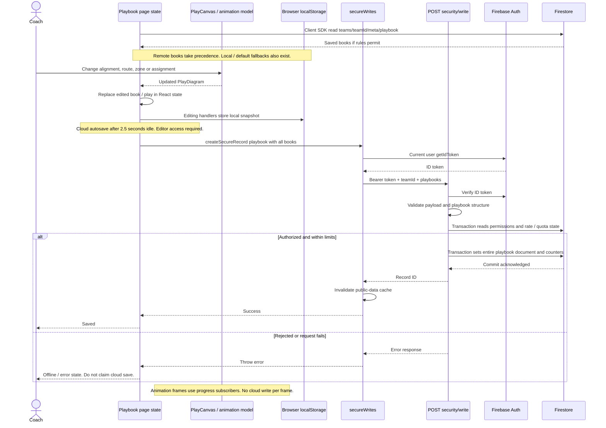

This is the coach-edit path, not player questions or every demo interaction.
Embedded showcase editing skips cloud autosave.

The save API **replaces the complete books array**. Its transaction protects the
server operation and counters, but there is no client revision/update-time
precondition in this save contract. Two devices editing an older snapshot can
overwrite each other; do not interpret "transaction" as optimistic editor conflict
resolution. Local storage is not a durable, multi-device sync queue.

**Evidence:** [load/edit/autosave flow](../src/app/teams/[id]/playbook/page.tsx),
[request helper](../src/lib/secureWrites.ts),
[playbook validation and transaction](../src/app/api/security/write/route.ts),
[canvas](../src/components/playbook/PlayCanvas.tsx).

## 8. Team, league and demo scope


Editable Mermaid source

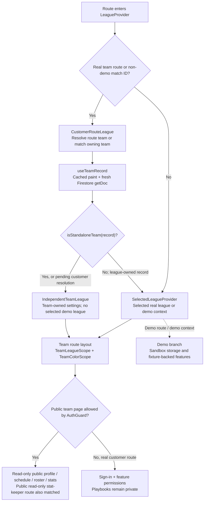

**Different checks have different purposes:**

- UI independent-team scoping: `isStandalone === true`, or no `leagueId` plus an
  active subscription. Customer resolution temporarily uses independent context
  until the owning record is known.
- Public summary eligibility: stored team has no `leagueId`, has
  `visibility: "public"`, and has none of the checked team PII fields.
- Demo team IDs: `demo` or `team_*` except `team_live_*`. This is an ID convention,
  not a database-enforced tenant type.
- A real customer team route ignores demo flags in `AuthGuard`; the broader
  application still contains explicit demo branches.
- Cached team records have in-memory/device persistence and **no TTL** in
  `teamRecord`; a hook load refreshes from Firestore. This is separate from the
  30-second public-data cache.

York uses the generic real-team path in this snapshot. There is no hardcoded York
summary identity or team-ID alias mapping in the scope resolver.

**Evidence:** [route/provider selection](../src/lib/leagueContext.tsx),
[team record loader](../src/lib/teamRecord.ts),
[demo classifiers](../src/lib/demoSandboxRuntime.ts),
[route guard](../src/components/AuthGuard.tsx),
[summary eligibility](../src/lib/teamStatSummaryService.ts).

## 9. Deployment and local development


Editable Mermaid source

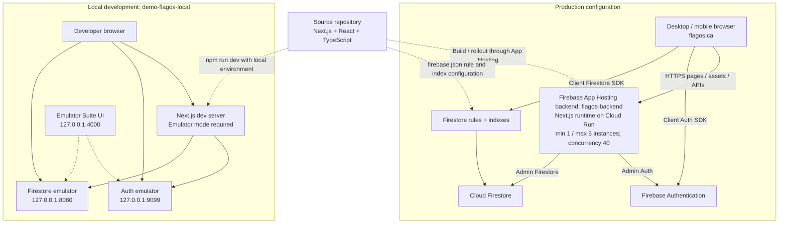

Deployment wiring is taken from configuration, not a live rollout inspection.
The diagram does not assert that every Git push deploys automatically, that rules
deploy together with application code, or that the current production revision is
this commit. Verify application rollout and rule deployment separately.

Production rejects emulator mode. Browser SDK initialization blocks development
mode without emulators; the Admin SDK blocks non-production access without
emulators. These are the repository's normal runtime guards, not an assertion
that production-preview processes or external maintenance scripts cannot access
production.

Firebase Storage is configured as a bucket name, but this view does not invent
an upload pipeline or separate worker service: none was established by this trace.

**Evidence:** [App Hosting config](../apphosting.yaml),
[Firebase deployment config](../firebase.json),
[Next.js config](../next.config.ts),
[client initialization](../src/lib/firebase.ts),
[server initialization](../src/lib/firebaseAdmin.ts),
[emulator workflow](local-firebase-emulators.md).

## Verification worksheet

These are review questions, **not assertions that a manual check has passed**.
This document does not change runtime behavior or perform a vulnerability audit.

| Check | Expected boundary / question | Where to verify |
|---|---|---|
| Signed-out team browsing | Public stored team profile can load; private playbook cannot | AuthGuard, summary route, rules |
| Independent team isolation | A remembered demo league must not supply a real independent team's settings or records | LeagueProvider, TeamLeagueScope, team record |
| Coach access | Own-team edit rights must be checked server-side, not only by UI flags | Write API authorization, team-private membership |
| Player playbook access | UI intends own-team read-only access and questions; verify backend agreement | Playbook page, meta rules, write API |
| League-admin playbook access | UI blocks a league admin not explicitly on the team; meta rules separately allow league-admin reads | Playbook page versus Firestore meta rules |
| Two-device editing | Whole-array saves currently have no editor revision conflict check | Playbook sequence and write contract |
| Correction visibility | Hidden/deleted/edited plays rebuild affected summaries after client invalidation | Summary service and cache |
| Schedule payload | Independent schedule loads matches, not all season plays | Team schedule and teamSeasonData |
| Local versus cloud | A device-local draft is not proof of cloud persistence | Autosave acknowledgement / offline indicator |
| Mobile performance | Measure TTFB, transferred JS, long tasks and data payload; no benchmark is implied here | Browser network / performance tools |
| Demo chunk loading | Check actual imports and build chunks, including TeamColorScope's direct sandbox import | Team color scope and bundle output |
| Deployment parity | Confirm deployed commit and rule revision independently | App Hosting rollout and Firebase deployment |

The two playbook permission rows deliberately expose **different statements at
different layers** rather than collapsing them into one misleading "RBAC" box.
They need role-based runtime tests before concluding that intended player and
league-admin behavior is consistent end-to-end.

## Maintaining this atlas

Update the corresponding Mermaid block when boundaries or contracts change, and
regenerate its numbered SVG. Keep SVGs static and self-contained so reviewers can
open them without sending architecture text to a third-party rendering service.
Revisit the snapshot marker whenever the atlas is revalidated against a new
revision. Do not treat old history, seeded demo data or production-only maintenance
scripts as current application code.
